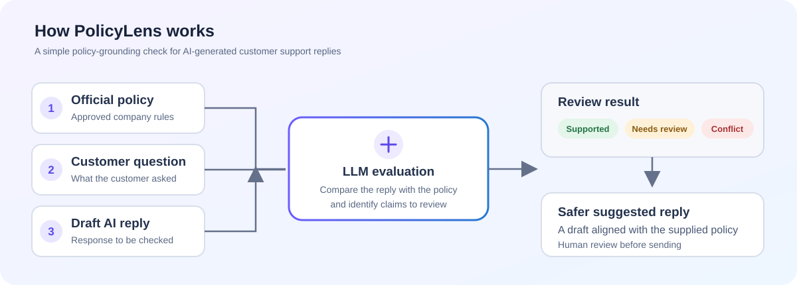

# PolicyLens — AI-Powered Customer Support Reply Checker

**PolicyLens checks whether an AI-generated customer-support reply is consistent with a company's official policy. It highlights possible contradictions and unsupported claims, then suggests a safer response.**

<p align="center">
  <a href="https://cynbit.streamlit.app/">
    <strong>🚀 Try the live Streamlit application</strong>
  </a>
</p>

---

## 1. Project at a glance

Customer-support teams increasingly use AI assistants to draft replies. A response can sound confident while still promising something the company's policy does not allow—for example, offering a 30-day return window when the approved policy allows only 14 days.

PolicyLens adds a simple review step: it compares the customer's question and an AI-generated draft with the official policy supplied by the user. It then reports whether the draft appears supported, needs human review, or contradicts the policy.

> **Important:** PolicyLens is a decision-support prototype. It does not guarantee factual correctness or automatically approve customer messages. A person should review the result before using it.

## 2. Application preview

### Workflow overview



### Streamlit application screenshot

To show the actual application in this section, take a screenshot of the deployed app and add it to the repository at:

`assets/policylens-screenshot.png`

Then add this Markdown line below (or replace this note with it):

```markdown

```

**Screenshot tip:** Capture the app with the input fields and an example result visible. Do not include your Groq API key, personal information, or confidential customer data in the screenshot.

## 3. How PolicyLens works

1. **Add the official policy** — paste the approved company rules or guidelines.
2. **Enter the customer's question** — provide the question that the support assistant is answering.
3. **Add the AI-generated reply** — paste the draft that needs to be checked.
4. **Run the evaluation** — PolicyLens sends the supplied text to a Groq-hosted language model with instructions to compare the draft only against the supplied policy.
5. **Review the result** — the app displays a status, explanation, supported points, claims to check, and a safer suggested reply.

### Result labels

| Status | Meaning |
|---|---|
| **Supported** | The important claims in the draft appear to be supported by the provided policy. |
| **Needs review** | The policy does not provide enough information to confidently verify one or more claims. |
| **Contradiction** | One or more claims in the draft appear to conflict with the provided policy. |

## 4. Example scenario

**Official policy**

- Returns are allowed within 14 days of delivery.
- Products must be unused and in their original packaging.
- Approved refunds are processed within 5–7 business days.

**Customer question**

> I received my headphones 20 days ago. Can I return them and get a refund tomorrow?

**Draft AI reply**

> Yes, you can return the headphones within 30 days, even if they have been used. Your refund will arrive tomorrow.

**What PolicyLens checks**

The draft's 30-day return window, acceptance of used products, and next-day refund promise should be flagged for review because they do not match the policy above. The exact classification and wording can vary because the assessment is generated by an LLM.

## 5. Features

- Checks AI-generated customer-support replies against user-provided policy text.
- Identifies possible contradictions and claims that lack policy evidence.
- Returns one of three easy-to-understand review statuses.
- Suggests an alternative reply that stays within the supplied policy.
- Provides a simple Streamlit interface for trying the workflow.
- Allows the user to enter a Groq API key in a masked field in the app rather than hardcoding it in the source code.
- Validates the structure of the model's JSON response before displaying the evaluation.
- Includes a sample case and unit tests for the response parsing and input-validation logic.

## 6. Technology stack

| Component | Technology | Purpose |
|---|---|---|
| Application language | Python | Input handling and evaluation workflow |
| User interface | Streamlit | Interactive web application |
| LLM integration | Groq API | Sends the evaluation request to a hosted language model |
| Prompt design | System prompt + structured input | Instructs the model to assess the draft against the supplied policy |
| Output handling | JSON parsing and validation | Checks that the response contains the expected fields |
| Testing | Python `unittest` | Tests input validation and response parsing |
| Version control | Git and GitHub | Tracks and shares the source code |

PolicyLens does **not** train a model from scratch. It uses a pretrained language model made available through the Groq API.

## 7. Run locally

### Prerequisites

- Python 3.10 or later
- A Groq API key: [Create or manage a key in the Groq Console](https://console.groq.com/keys)
- Internet access for the application to call the Groq API

### Windows — PowerShell

```powershell
# 1. Create a virtual environment
py -m venv .venv

# 2. Activate it
.\.venv\Scripts\Activate.ps1

# 3. Install dependencies
python -m pip install --upgrade pip
pip install -r requirements.txt

# 4. Run the tests
python -m unittest discover -s tests -v

# 5. Start the application
streamlit run app.py
```

### macOS / Linux

```bash
# 1. Create and activate a virtual environment
python3 -m venv .venv
source .venv/bin/activate

# 2. Install dependencies
python -m pip install --upgrade pip
pip install -r requirements.txt

# 3. Run the tests
python -m unittest discover -s tests -v

# 4. Start the application
streamlit run app.py
```

After Streamlit starts, open the local URL printed in the terminal. Enter your Groq API key in the **AI settings** section of the sidebar, review the sample input, and click **Check reply**.

If PowerShell does not allow virtual-environment activation, you can run the environment's Python directly:

```powershell
.\.venv\Scripts\python.exe -m pip install -r requirements.txt
.\.venv\Scripts\python.exe -m streamlit run app.py
```

## 8. API key and data handling

- The application asks for the Groq API key in a masked password field in the Streamlit sidebar.
- The current code does not read the key from environment variables, a `.env` file, or Streamlit secrets.
- The key is held in the active Streamlit session and is used when the app sends a request to Groq. The code does not intentionally write the key to a project file.
- Use **Clear API key** to clear the key from the active session.
- The policy, customer question, and draft reply are sent to Groq as part of the evaluation request. Use fictional or non-confidential data for the public demo.
- Never commit an actual API key, a real `.env` file, or a screenshot containing credentials to GitHub.
- The included `.env.example` is documentation only; it contains no secret and is not loaded by the application.

Because the live demo is publicly accessible, do not enter a sensitive or privileged API key unless you are comfortable sending it through the deployed application. For a production multi-user deployment, use proper server-side secret management, authentication, access controls, and privacy review instead of asking end users to provide a shared service key.

## 9. Project structure

```text
cynbit_policylens_updated/
├── app.py                         # Streamlit user interface
├── checker.py                     # Groq request and response validation
├── requirements.txt               # Python dependencies
├── .env.example                   # Configuration/security note; no key
├── .gitignore                     # Excludes local secrets and virtual environments
├── AI_OPPORTUNITY_REPORT.md       # Business opportunity analysis
├── TECHNICAL_APPROACH_REPORT.md  # Technical design and implementation approach
├── TEST_PLAN.md                   # Test plan
├── sample_data/
│   └── sample_case.json           # Example policy, question, and draft reply
├── tests/
│   └── test_checker.py            # Unit tests
└── assets/
    ├── policylens-workflow.svg    # Workflow illustration used in this README
    └── policylens-screenshot.png  # Add your real app screenshot here
```

## 10. Relevance to Cynbit Technologies

I developed PolicyLens as a candidate project for the **AI/ML Engineer Intern** assessment. Cynbit's public role description highlights building AI chatbots and virtual assistants, prompt engineering for LLMs, document-processing pipelines, and integrating emerging AI/ML technologies. Cynbit's services page also describes autonomous agents, LLM automation, and AI-stack integration.

PolicyLens is relevant to that work because it demonstrates a lightweight quality-checking step that could sit alongside an AI assistant or customer-support workflow. It shows practical implementation of:

- Python application development.
- LLM API integration.
- Prompt design for a specific business task.
- Structured model-output validation and error handling.
- A usable web interface for an AI workflow.

This is an independent prototype based on publicly described areas of Cynbit's work. It does not use Cynbit's internal data, and it is not a claim that Cynbit has a confirmed internal requirement for this tool.

**Public references:**

- [Cynbit — AI/ML Engineer Intern role](https://www.cynbit.in/careers/ai-ml-engineer-intern)
- [Cynbit — Services and AI automation](https://www.cynbit.in/services)

## 11. Limitations and future improvements

### Current limitations

- LLM evaluations may be incorrect, incomplete, or inconsistent.
- The result depends on the accuracy and completeness of the policy text supplied by the user.
- The prototype does not independently verify company policies or external facts.
- Unit tests validate application logic and response structure; they do not prove that the model's policy judgments are always correct.
- Human review is required before a customer-facing response is sent.

### Possible future improvements

- Add a set of repeatable evaluation examples and track model performance over time.
- Support policy files and source references in addition to pasted text.
- Add a review history with appropriate privacy and retention controls.
- Compare different LLMs and prompts using a labelled evaluation dataset.

## 12. Project links

- **Live application:** [https://cynbit.streamlit.app/](https://cynbit.streamlit.app/)
- **Source code:** This GitHub repository

---

**Built as an AI/ML Engineer Intern assessment project for Cynbit Technologies.**
